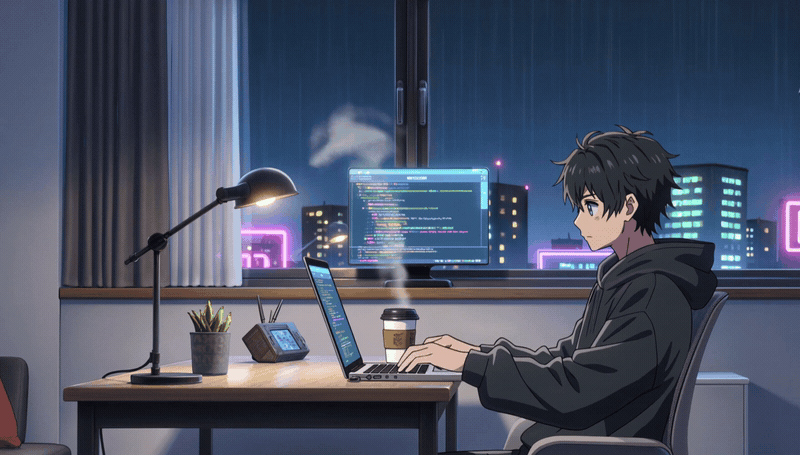

# Hi, I'm Pierre 👋

**Computer Science Student · Aspiring Software Engineer**

*Turning curiosity into code and ideas into meaningful digital experiences.*

---

### About Me

I'm a Computer Science student who enjoys exploring how software can solve everyday problems and bring creative ideas to life. I'm passionate about building practical applications, improving my development skills, and learning through hands-on experience.

I believe great software starts with curiosity, thoughtful design, and a willingness to keep learning.

### What I'm Exploring

- **Software Development** — writing maintainable code and learning better engineering practices.
- **Mobile & Android Development** — creating useful, intuitive application experiences.
- **Creative Coding** — experimenting with interactive ideas and personal projects.
- **Continuous Learning** — strengthening my foundations in computer science and problem-solving.

### My Approach

> Learn with purpose. Build with curiosity. Improve with every iteration.

### Let's Connect

I'm always interested in learning new technologies, exchanging ideas, and connecting with other developers.

Thanks for visiting my profile.

